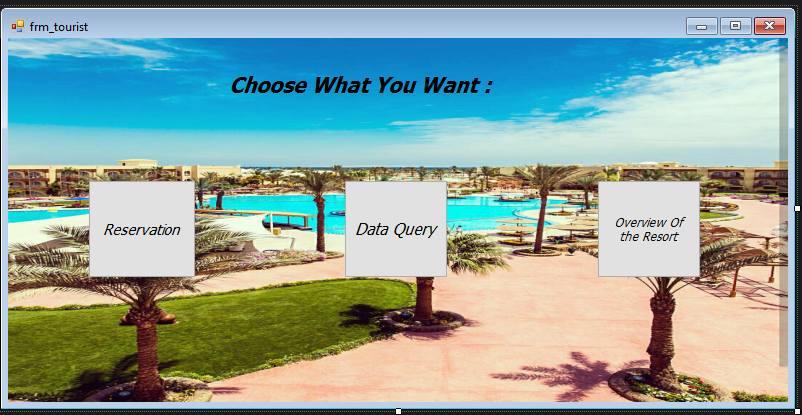
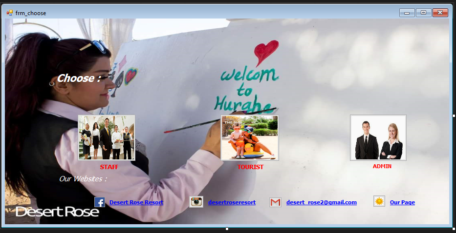
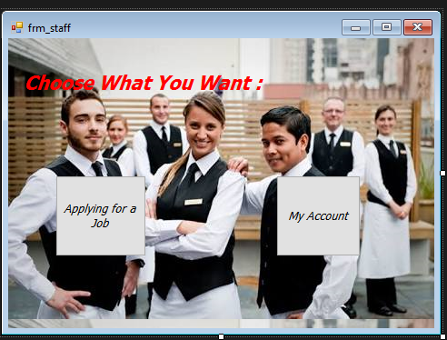
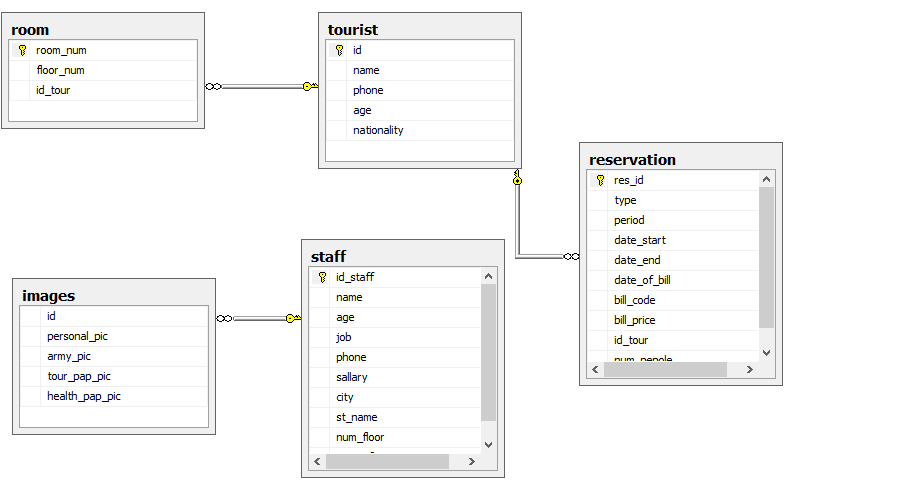

# Desert Rose Resort: Management System

> A Windows desktop application for running a resort: reservations, rooms, tourists, staff, restaurant and room service, tours and billing. Built with C# WinForms and SQL Server.

| Login | Main menu |
| --- | --- |
|  |  |
| **Reception** | **Staff** |
|  |  |

## Features

- **Login** for admin and staff accounts.
- **Reservations:** book a room, choose the room type and period, and cancel or delete reservations.
- **Rooms and tourists:** add and delete rooms, and manage tourist information.
- **Billing:** bill code, date and price for each stay.
- **Tours and activities:** safari, glass boat, aqua park and beach packages.
- **Staff:** job applications, staff accounts, shifts and dismissals.
- **Managers:** restaurant manager, room-service manager and guardian/manager screens.
- **Data query:** search the stored data by ID.

## Database

## Run it

1. Open `Desert Rose Resort.sln` in Visual Studio.
2. In SQL Server Management Studio, attach `database/DesertRoseResort.mdf` with the database name **`DESERT ROSE RESORT1`**.
3. Update the server name (`Data Source=...`) in the connection string in the forms to your SQL Server instance.
4. Build and run (F5).

## Author

**Ahmed Gamal Saber**, Full-Stack Web Developer & AI Engineer
[LinkedIn](https://linkedin.com/in/ahmed-gamal-saber-382081169) · [GitHub](https://github.com/AhmedGamal98)
